# aws-3tier-webapp
This is a repository that shows how to deploy a webapp using AWS

# AWS 3-Tier Web App

Short description: a notes app on AWS with a load balancer, auto scaling
web tier in private subnets, and a private RDS database.

## Architecture

## What's in it
- Custom VPC, 2 Availability Zones, public / private app / private DB subnets
- ALB in public subnets, EC2 in an Auto Scaling group in private subnets
- RDS MySQL in private DB subnets (no public access)
- NAT gateway for outbound-only internet access
- IAM role + Parameter Store (no credentials in code)
- CloudWatch alarms

## Security Group Configuration
| Security group | Allows | From |
|---|---|---|
| alb-sg | HTTP 80 | Internet |
| app-sg | HTTP 80 | alb-sg |
| db-sg | MySQL 3306 | app-sg |

(Plus: no SSH port open, SSM Session Manager for access,
IAM policy limited to /webapp/db/* parameters, IMDSv2 only.)

## Proof it works
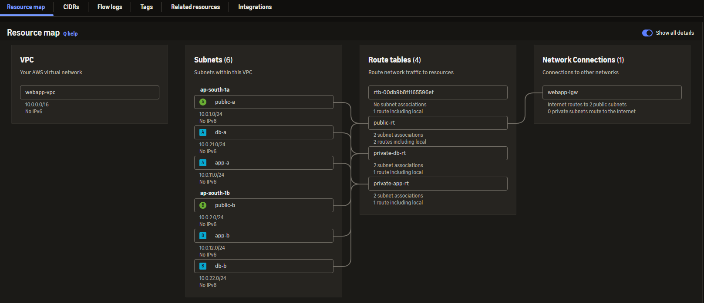
-This shows the first step in the deployment where a VPC is created with 6 subnets and 3 security groups
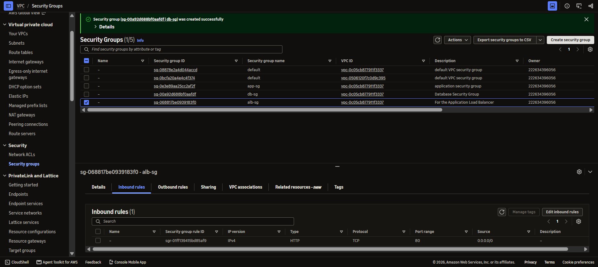
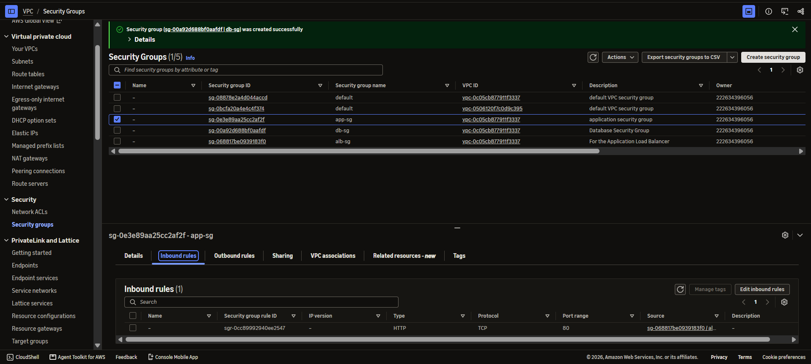
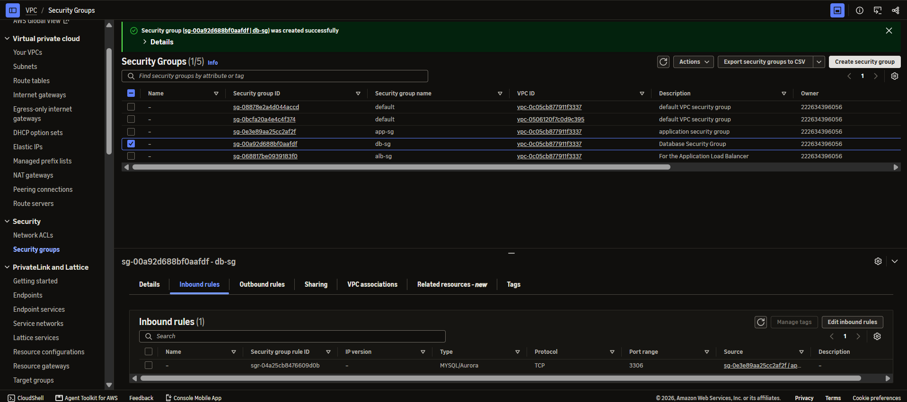
-The 3 security Groups are created for the services
-Application Security Group is for EC2 instances
-The other 2 are for their respective services
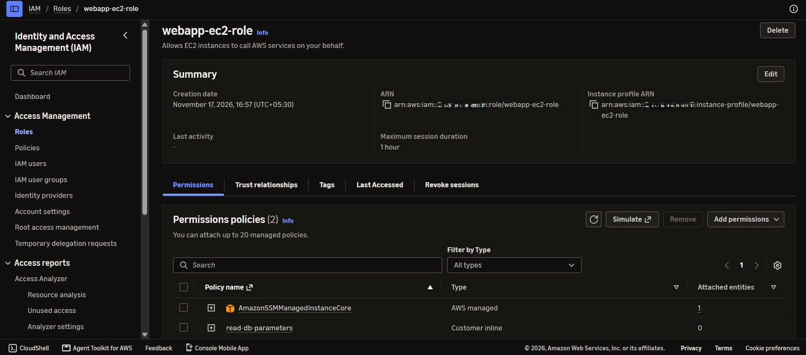
-IAM(Identity and Access Management) Role Policy is created
-AmazonSSMManagedInstanceCore lets us use the Session Manager to directly login to the EC2 instance
-the other is used to let us read the secret password in Parameter Store and the host Endpoint
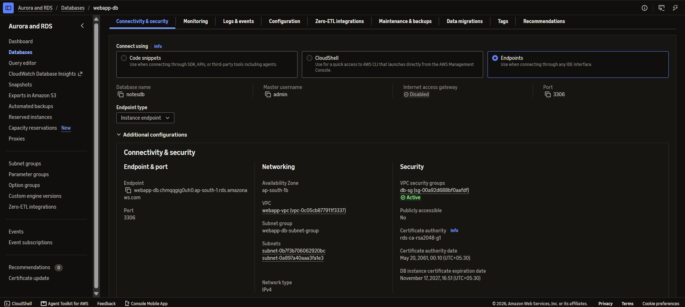
-The Relational Database Instance is created for MySQL to store the data that will be inserted in the notes web app
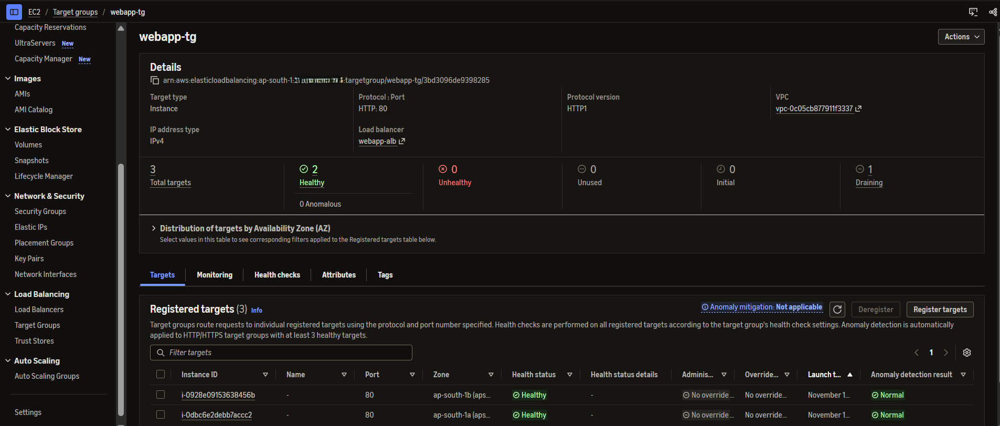
-Load Balancer and Target Groups are created and the Auto Scaling group is started
-Here we can see that both the instances started and are healthy
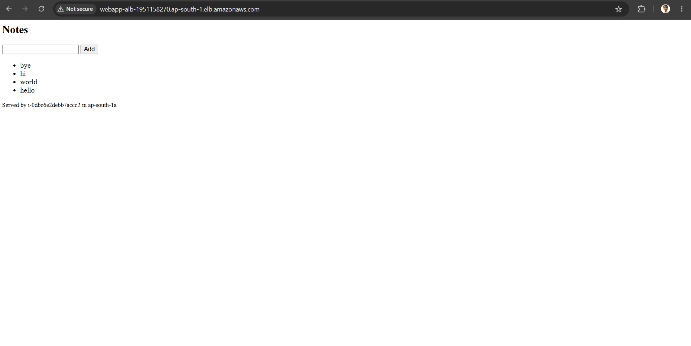
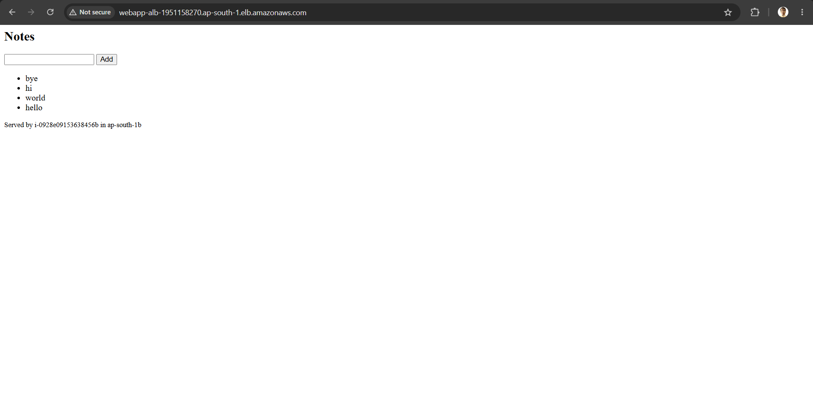
-We use the VPC link to go to the webapp and insert a few entries
-If we reload the page we can see the other server as well
-The other instance starts functioning alone if one of the instances is terminated
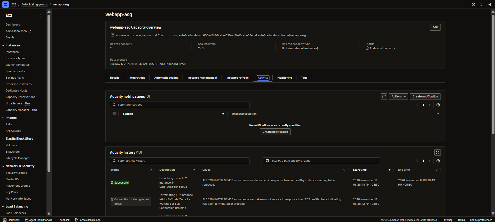
-We can see that the auto scaling group starts a new instance automatically, since one of the instances was shut down
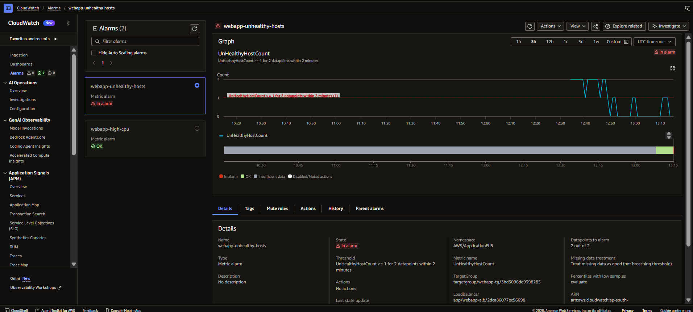
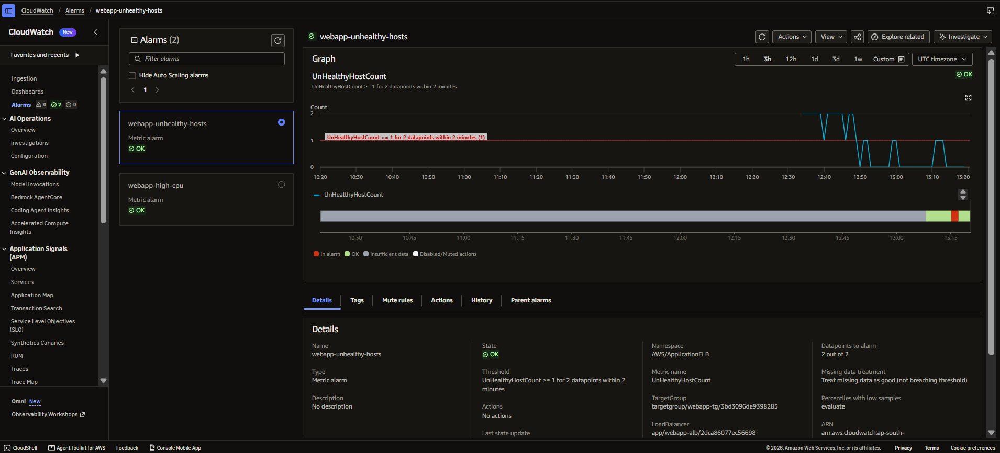
-Here the Cloud Watch service is working as intended as , when I stopped the webapp in one of the instances it started the alarm.
-It also stopped the alarm and went back to normal once the webapp was started again

## Resilience test
As we could see from the Auto Scaling Group Screenshot , It automatically started a new instance once the old one went down

## Cost notes and trade-offs
- One NAT gateway (single point of failure, chosen for cost)
- Single-AZ RDS (Multi-AZ left optional for cost)
- Everything deleted after the demo

## What I'd do next
Terraform, GitHub Actions pipeline, HTTPS with ACM, S3 gateway endpoint
