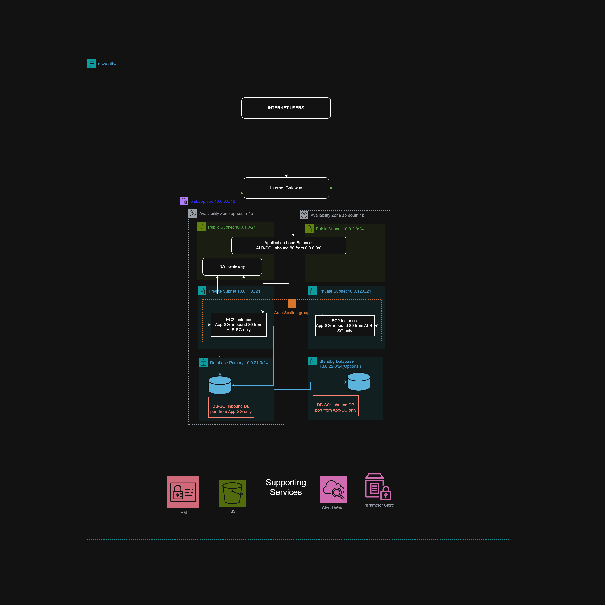

# aws-3tier-webapp
This is a repository that shows how to deploy a webapp using AWS

# AWS 3-Tier Web App

Short description: a notes app on AWS with a load balancer, auto scaling
web tier in private subnets, and a private RDS database.

## Architecture

## What's in it
- Custom VPC, 2 AZs, public / private app / private DB subnets
- ALB in public subnets, EC2 in an Auto Scaling group in private subnets
- RDS MySQL in private DB subnets (no public access)
- NAT gateway for outbound-only internet access
- IAM role + Parameter Store (no credentials in code)
- CloudWatch alarms

## Security decisions
| Security group | Allows | From |
|---|---|---|
| alb-sg | HTTP 80 | Internet |
| app-sg | HTTP 80 | alb-sg |
| db-sg | MySQL 3306 | app-sg |

(Plus: no SSH port open, SSM Session Manager for access,
IAM policy limited to /webapp/db/* parameters, IMDSv2 only.)

## Proof it works
(screenshots with one-line captions)

## Resilience test
Terminated an instance, the site stayed up, ASG launched a replacement.

## Cost notes and trade-offs
- One NAT gateway (single point of failure, chosen for cost)
- Single-AZ RDS (Multi-AZ left optional for cost)
- Everything deleted after the demo

## What I'd do next
Terraform, GitHub Actions pipeline, HTTPS with ACM, S3 gateway endpoint